 

 **Full Stack Developer**   |   **2+ Year Production Experience**   |   **Building Scalable Systems**

 

&nbsp;

&nbsp;

 

Welcome to my GitHub profile! I'm **Muhammad Daniyal Tallat**, a **Full Stack Developer** with **2+ years of production experience** building scalable, high-performance, and production-ready web applications.

I specialize in **MERN, MEAN, and Django-based full-stack development**, working with React, Next.js, Angular, Node.js, Express, **Django, Django REST Framework (DRF)**, Python, MongoDB, MySQL, and modern API architectures.

I enjoy building real-world systems end-to-end — from **database design and backend architecture to REST APIs, authentication, role-based systems, real-time features, integrations, and deployment**. I'm also constantly exploring **AI tools, emerging developer tools, automation, and crazy experimental technologies** that can improve the way software is built.

---

## 👨‍💻 About Me

* **Education**: BS (Hons) in Computer Science, Government College University (GCU), Lahore
* **Current Role**: Software Engineer Intern @ Devsinc
* **Specialties**: MERN/MEAN Stack, Django/Django REST Framework (DRF), REST APIs, MySQL, MongoDB, PostgreSQL, Redis, SQLite, Database Design,     Role-Based Systems, Scalable Architecture
* **Exploring**: AI tools, AI-assisted development, automation, emerging technologies, and crazy developer tools
* **GitHub**: [Daniyal00001](https://github.com/Daniyal00001)
* **Email**: [daniyaltallat0@gmail.com](mailto:daniyaltallat0@gmail.com)

---

## 💻 Tech Stack ⚡

---

<h2 align="center">🌟 GitHub Stats</h2>

  
  

  
  

---

<h2>🐍 Contribution Snake</h2>

<picture>
  <source media="(prefers-color-scheme: dark)" srcset="https://raw.githubusercontent.com/Daniyal00001/Daniyal00001/output/github-snake-dark.svg" />
  <source media="(prefers-color-scheme: light)" srcset="https://raw.githubusercontent.com/Daniyal00001/Daniyal00001/output/github-snake.svg" />
  
</picture>

---

## 🌱 Hobbies & Interests

* **Continuous Learning:** Exploring backend architecture, DSA, system design, and new technologies
* **AI Exploration:** Experimenting with AI tools, AI-assisted development, and emerging AI technologies
* **Tech Community:** Supporting production systems used by thousands of real users
* **Problem Solving:** Enjoy tackling practical, real-world engineering problems

---

## 📫 Get in Touch

---

**Thank you for visiting!** 🚀

